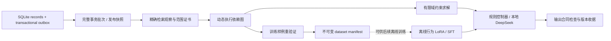

# DeltaWeave

**让数据库变更可验证地传递到检索、Agent 回答和 SFT 训练数据。**

这个项目研究一个具体问题：数据库新增、修改或撤回知识后，哪些旧工具结果和回答仍然有效，哪些节点必须重新执行，哪些训练样例需要重标？底座采用官方 DeepSeek-R1-Distill-Qwen-1.5B，模型实验完全在本机 Mac 上运行。

研究把更新的正确性条件、复用边界和维护成本放在同一套可重放实验里。默认采用确定性规则控制器；DeepSeek 与两种真实 LoRA 用于独立验证行为适配的收益和局限。

[为什么这样设计](docs/framework-selection.md) · [运行结果与失败分析](docs/results.md) · [框架语义](docs/architecture.md) · [最近邻研究](research/prior-work.md) · [本机验收](docs/release-check.md)

## 研究结论与证据

最终有限状态回放中，full/coarse/predicate/adaptive 通过全部 384 个状态转换；只跟踪已返回记录的消融漏掉 82 个转换。原因是新增候选和空查询变非空没有旧引用边。

加入所有模式共享的等值索引后，按项目范围验证已经得到大部分收益。细粒度谓词在高扇出更新中反而更慢。因此默认使用较简单的 `coarse`，另提供有明确计费的 `adaptive` 全量回退，而不是假设依赖越细越高效。

真实 PyPI 文件元数据与合成变化的最终域实验包含 74 条链、157 个状态；四个安全模式全部与独立有限枚举 oracle 一致。这只验证已声明有限候选集合的约束，不代表所有 PyPI 版本或实际运行兼容性。

| 实测项目 | 结果 | 解释范围 |
|---|---|---|
| 2,400 行、低变化且重复请求的四类负载 | coarse 累计 44–48 ms，full 104–108 ms | 5 次重复中位数，含初建与维护；仅更新内核 |
| 高扇出更新 | full 625 ms，coarse 677 ms，predicate 1,483 ms | 更细的依赖维护可能更慢 |
| 冻结 test，原模型 / QA SFT / 行为 SFT | 4/32、20/32、32/32 | 完整 JSON 动作与载荷，不只格式 |
| 未见条件组合 future，同三模型 | 2/32、20/32、24/32 | 合成组合集；行为模型仍会误用过期 conflict |

每个模型 split 只有 4 个独立世界，不能将其 32 个相关状态当成 32 个独立任务。短样本高分也未外推到长证据：随后独立冻结的 16 条更新链中，完整复制与保留完整上下文的引用视图均只完成 12/48 个会话，压缩引用为 23/48；规则主路径在三视图均为 48/48。**模型路线仍有明显局限，发布的是可核验的更新框架与研究结果。** 错误预测被阻断并原样公开，规则兜底没有计入模型成功。原始输出、较早六事件开发失败及完整分析见 [结果页](docs/results.md)。


## 数据库、Agent、RAG、SFT 如何协同



- **知识更新**：SQLite 一笔事务同时写记录与 outbox；发布器按序、幂等消费，所有工具固定同一个不可变快照。
- **RAG**：首版是有明确集合范围的结构化检索。正读、空查询和未来新增项的适用域都要追踪；不声称精确覆盖任意向量语义检索。
- **Agent**：沿旧执行轨迹按需验证；前驱改变后重新执行并发现新分支。即便结果相同，也替换新读集。完整公开结果相等时停止向下游传播。
- **模型**：优先让精确工具解决声明约束。DeepSeek 的原始动作单独记录，错误输出被显式阻断；规则兜底不能计为模型成功。所有路线可使用完整语义提示缓存。
- **SFT**：样例、标签和来源快照一起冻结；先区分缺数据、旧证据和行为错误。更新样例不会自动清除旧权重记忆，数据库每次写入也不自动触发训练。

本轮 LoRA 使用单独冻结的合成状态控制数据；SQLite 回放验证样例血缘和重标流程，未声称已经用这些回放样例完成在线持续训练。独立枚举 oracle 在评测中核验领域结果，不冒充模型生成步骤。

数据库中的包依赖图与 Agent 的执行图是两个对象。完整机制与条件证明见 [架构说明](docs/architecture.md)、[更新语义](research/update-semantics.md)；路线选择及反例见 [研究决策](research/decision-2026-10-28.md) 和 [挑战集](research/challenges.md)。

## 不需要模型也能完整运行

建议 Python 3.12；支持 Python 3.10+。从仓库源码以 editable 模式安装：

```bash
python3.12 -m venv .venv
source .venv/bin/activate
python -m pip install -e '.[test]'
python -m pytest -q

python -m deltaweave resolve 'requests>=2.31'
python -m deltaweave demo --output runs/demo-rule --mode coarse
```

demo 会真实创建本地 SQLite，回放新增组织限制、无关政策变化、撤销限制、文件撤回与完整性证书删除，生成每步回答/工具收据及不可变训练数据清单。事件属于**合成实验覆盖层**，不是实际 PyPI 事故。输出目录必须是新目录，旧实验不被覆盖。

`full` 从头执行并共享同快照调用；`coarse` 用项目范围与相等截断；`predicate` 增加细粒度成员检查；`adaptive` 在已冻结的事件密度阈值上选择安全的 full/coarse。`positive` 仅供失效消融，不作为可部署模式。

## 本地 DeepSeek 与微调

固定模型 revision：`ad9f0ae0864d7fbcd1cd905e3c6c5b069cc8b562`。权重约 3.55 GB，下载会校验官方文件摘要；仓库不包含底座权重，不使用付费推理 API。Apple Silicon 实验配置见 [模型卡](docs/model-card.md)。

```bash
python -m pip install -r requirements-model-tested.txt
python scripts/download_model.py
python scripts/build_learning_data.py

python scripts/train_adapter.py --data data/learning/train_qa.jsonl \
  --output runs/qa --steps 512 --target-supervised-tokens 16384
python scripts/train_adapter.py --data data/learning/train_behavior.jsonl \
  --output runs/behavior --steps 512 --target-supervised-tokens 16384

python scripts/evaluate_model.py --data data/learning/test.jsonl \
  --adapter runs/behavior/adapter --output runs/behavior-test.json
python -m deltaweave demo --output runs/demo-deepseek --mode coarse \
  --model .cache/deepseek-r1-distill-qwen-1.5b --adapter runs/behavior/adapter
```

已训练 adapter 和确定性训练数据通过版本化 Release 附件提供，避免将底座或大型权重塞入源码历史。取得并逐文件校验后可直接使用 `artifacts/behavior`，无需重新训练：

```bash
python scripts/fetch_release.py
python -m deltaweave demo --output runs/demo-released --mode coarse \
  --model .cache/deepseek-r1-distill-qwen-1.5b --adapter artifacts/behavior
```

模型实验严格拆开：冻结模型的知识刷新、相同证据下 QA/行为 SFT 的差异，以及冻结 adapter 面对未见实体/条件组合。当前状态控制数据是可审核的合成接口任务，规则策略本来就能执行其合同；不能拿该分数宣称通用问答提升。正式分组、预算、失败分母和保留集规则见 [模型协议](research/protocol-v1.md)。

`--evidence-view reference_context` 保留完整事实输入、改用绑定引用输出；`--evidence-view reference` 同时缩小输入。宿主在验证后展开完整结果，展开的版本与引用不计作模型生成。两者是实验接口；完整输出、错误引用、缓存命中与实际生成分开记录。默认 `full` 保留原合同。

## 复现与边界

```bash
python scripts/benchmark_domain.py --output runs/domain.json
python scripts/benchmark_updates.py --output runs/updates.json \
  --sizes 240 2400 --steps 12 --seed 93 --repeats 5
```

更新内核的累计墙钟时间包括首建、索引、内存 Store 提交、查询、证书检查和图维护；不含远端抓取、SQLite 磁盘同步、模型推理或训练。没有用模拟 LLM 延迟冒充端到端加速。高扇出与低复用负载也是基准的一部分，定量表需要结合数据规模和重复区间阅读。

条件化重跑一致性要求完整可见输入、可靠变更事件、同快照和确定节点；它不等于模型答案正确。执行器保留内存历史，SQLite 适配器偏重可审计性，尚不提供大规模分布式 CDC、压缩历史、生产权限隔离或参数遗忘保证。

动态依赖、谓词失效、相等截断已有经典工作。项目对 [LightRAG、Graphiti、Pathway、Debezium 及理论近邻](research/prior-work.md) 做了机制审查，没有将它们改名，也没有声称击败未实际复现的系统。[许可证与归属](NOTICE.md)。
