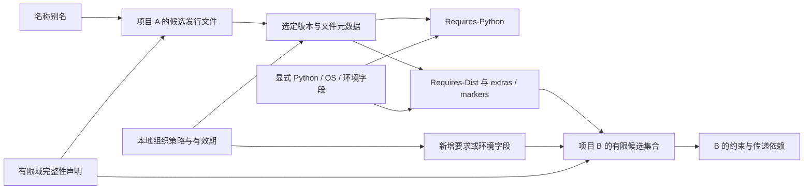
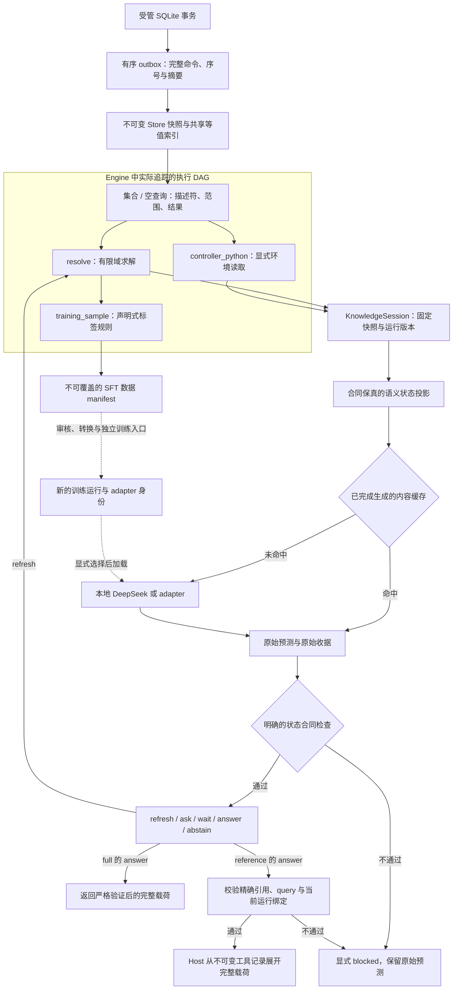

# DeltaWeave：更新框架的语义与实现边界

本文描述当前实现，不预填模型训练或最终确认集成绩。正式模型比较以 [首轮冻结协议](../research/protocol-v1.md) 为准；更新算法的条件论证、反例和成本式见 [update-semantics.md](../research/update-semantics.md)。

DeltaWeave 研究一个具体问题：数据库变化之后，哪些工具观测和派生结果仍可复用，哪些必须重算，何时才值得重新训练模型。当前选择是**以项目范围校验与经典相等截断作为默认路径**，保留完整重算、细粒度谓词和固定密度回退作对照。规则控制器可以作为最终主路径；模型并不是为了完整性而强行加入的组件。

## 1. 两张图，解决不同的问题

第一张是**领域知识依赖图**。它由发行文件的声明依赖、环境条件和组织策略构成，决定某个有限候选域内是否存在满足约束的选择。当前图没有另存进图数据库，而是由结构化表和求解过程表达。

第二张是**执行依赖图**。它记录程序实际调用过的查询和子任务，以及当时看见的完整公开结果。它回答“这一结果依赖哪些读取”，不代替领域约束求解。

图中的模型调用当前由会话层管理，**不属于 Engine 内部的计算节点**；其跨快照复用依靠独立的完整提示内容缓存。SFT 清单也不会自动触发训练。箭头中的虚线表示显式后续操作，不代表已实现在线自训练。

实际领域求解器目前注册为一个 `resolve` 计算节点，内部查询通过 `ctx.query` 追踪；尚未把每次回溯、每个约束或每个候选都拆成细粒度缓存节点。这个粒度会限制局部更新收益，不能从图示推导已实现所有中间状态的复用。

## 2. 数据与独立真值的范围

[domain.py](../src/deltaweave/domain.py) 使用 `projects`、`releases`、`aliases`、`policies` 和 `environment` 五张表。公开输入来自选定 PyPI universal-wheel 文件的元数据；组织策略及之后的更新回放是明确标注的本地实验覆盖，不代表真实 PyPI 事故。

`projects.complete=True` 只声明本地选定发行文件域完整。缺少项目、元数据、所需环境字段、无法处理的要求或搜索预算耗尽，都产生 `incomplete`；已认证的有限候选域无解才产生 `conflict`。结果不证明所有 PyPI 版本无解，也不证明软件实际运行兼容。

`packaging` 负责 requirement、版本与 marker 的解释，生产求解器负责有限搜索。[oracle.py](../src/deltaweave/oracle.py) 提供独立枚举路径用于外部核验。独立 oracle 并不在每次线上查询或每条账本样例上自动执行；因此账本标签应称“生产求解器输出经声明规则生成”，不能称为已经逐条获得独立真值证明。

当前每个项目/版本只接受一个选定元数据记录；遇到同版本多份可能冲突的文件元数据返回未知，不静默合并。Yank 在本项目中统一排除，包括精确 pin；这是明确的本地策略，不是对 pip 全部例外行为的复现。引用记录的是求解过程中观察到的来源，不是最小冲突核。

## 3. 数据库更新如何成为可发布状态

[SQLiteSource / SQLitePublisher](../src/deltaweave/sqlite_source.py) 实现受管本地 SQLite 数据库：行更新、持久 revision 和 outbox 写在同一事务内。命令采用稳定 `request_id` 和预期 revision；同 ID 重复提交相同命令可以识别，改用不同命令则拒绝。发布器按序应用完整事务，遇到序号缺口、不同来源或越过发布器直接修改 Store 时失败，要求显式处理。

持久数据库的 `source_revision` 与重启后从零开始的 `Store.revision` 是两个编号。发布器保留它们的映射；审计记录绑定的是回答实际使用的本地快照，而不是日志生成时可能更晚的数据库头部。

[Store](../src/deltaweave/store.py) 的快照、行内容和索引是不可变结构，公开读取提供防御性副本。一次多表提交先验证全批操作，再一起发布；旧快照可以继续读取。相同 ID 的 old/new 事件用于范围守卫；未改变内容的 upsert 不制造假变化。索引是所有执行模式共享的精确标量等值 postings，未变表和索引结构尽量共享。`Store(indexed=False)` 保留同语义扫描对照。

这是一种本地、受控的发布模型，不是任意外部数据库的 CDC 连接器。当前没有后台自动轮询；一个 poll 中的多个源事务逐一原子发布，不承诺把整个 poll 合并成一个事务。SQLite 写入路径为了验证，会物化现有数据；不能将其称为只与变更量成正比的高吞吐 CDC。outbox 和内存历史目前保留，不提供有界存储保证。

## 4. 查询证书与动态执行

[Engine](../src/deltaweave/engine.py) 支持确定的等值查询、指定字段投影、标量升序排序、稳定 ID 平局规则及 limit。`select` 不会偷偷加回 ID：公开观测与内部返回行来源分开记录。空集合同样有查询描述符和订阅范围。

范围守卫的核心要求为：**只要工具的公开结果变化，就必须触发验证**。可以多触发，不能漏触发。新行没有旧引用边，所以不能只检查旧返回 ID；更新和删除也必须检查 old/new 两侧。查询结果采用规范化 JSON 字节比较，实际停止条件不依赖“语义相似”判断。

任务按旧轨迹中的读取顺序验证，遇到第一个不同的前驱就重跑当前任务，从执行中发现新调用。已无效的旧分支不会被盲目执行。即使重跑后的输出相同，也先保存新的读集，再停止向调用者传播；否则下一次新依赖变化会丢失触发路径。

| 模式 | 实际行为 | 使用边界 |
|---|---|---|
| `full` | 新快照完整执行；同快照相同任务和查询共享 memo | 强正确性/成本参照，不能人为禁止共享 |
| `positive` | 只用旧返回行 ID 触发 | 刻意不完整的反例基线；会漏新候选与空查询插入，Session 和 TrainingLedger 拒绝使用 |
| `coarse` | 使用查询的显式等值子范围；默认有 `project` 时用项目范围，否则整张表；重查询后做相等截断 | 当前默认；范围可保守，但必须覆盖真实查询 |
| `predicate` | 用完整等值 where 对事件 old/new 作成员检查；其余执行与 coarse 相同 | 保留成本对照，不预设越细越快 |
| `adaptive` | 固定密度启发式在 full 与 coarse 之间选择 | 实验性调度，不预测未经校验的值是否正确 |

Adaptive 的具体规则已写入代码：冷根使用 full；否则计算从该根上次验证到目标快照的完整事件数量，除以 `max(1, 当前快照全部源行数)`，严格大于 **0.25** 时选 full，其余选 coarse。事件数使用提交时维护的前缀计数；这是全域密度，不是根的实际受影响比例，同一行跨多个批次反复更新也会累计。

回退到 full 仍然保存新的动态轨迹，下一次可以安全回到 coarse。每次 `execution_policy` 收据记录模式、原因、分子、分母与阈值；执行统计记录真实工作，不把“选择 full”写成实际调用了每个模型。这个策略在开发阶段提出，尚不能因为一个场景更快就称为全局最小前沿或最优在线算法。

## 5. 数据快照、运行版本与语义提示是三种身份

不能把全局 `snapshot_id` 当作每个模型提示的 nonce，否则无关数据更新也会使全部提示缓存失效。当前分工如下：

| 身份 | 实际绑定 | 不应推导的含义 |
|---|---|---|
| 数据快照 | revision、按表和稳定行 ID 规范化的源内容 SHA256 | 单个 revision 数字不具有跨数据库唯一性 |
| 执行配置 | 已注册任务名和声明版本的 fingerprint | 不是自动分析函数代码、闭包或模型权重得出的完整哈希 |
| 模型计算 | 完整语义 prompt 与显式 `policy_identity` | 不能只用“模型名称”代替 adapter、解码、seed 的身份 |

[provenance.py](../src/deltaweave/provenance.py) 为会话、账本与其他调用者提供同一快照摘要规范。会话和清单同时记录数据与注册版本绑定。数据库 revision 不变而求解器版本变化时，旧观察也必须失效；一次请求中注册版本发生变化会显式阻断完成，不拼接两个配置的结果。

`normalize_state` 只在当前**等值状态合同**中将“已验证到当前版本/旧版本”映射为稳定标记。原始 revision、来源与完整 query 保留在 host 收据中。`as_of` 和环境参数仍然进入实际求解；当前模型控制器不负责独立日期推理。这个归一化不能未经验证推广到需要计算版本差、时间距离或历史先后顺序的任务。

未变的结果可推进 `validated_at`，但保留原始 `computed_at` 和执行出处；不能把复用记成模型重新生成。完整重算模式也可使用同样的跨快照语义生成缓存。如果普通内容缓存已经省掉相同模型调用，增量图只能报告额外省掉的工具工作，不能重复归功。

## 6. 会话控制、原始模型输出与规则检查

[KnowledgeSession](../src/deltaweave/session.py) 在开始时固定一个源快照。它读取显式 Python 环境，复用或刷新绑定正确的求解观察，然后在有限动作预算内选择 `wait / ask / refresh / answer / abstain`。

默认 policy 是公开的规则控制器。可选模型必须提供明确、非规则的 `policy_identity`；构造后 policy 与身份只读。CLI 的本地模型包装把底座/adapter 文件来源、解码设置和实现来源纳入身份，并按提示派生 seed。底层 Session 接受的是通用 callable，因此调用者仍须如实声明该身份；框架不检查任意闭包内部的隐藏状态。

模型预测不会被规则目标替换。规则只决定是否接受；错误、未完成或合同不匹配产生显式 blocked，保留原始预测。缓存保存**全部已完成的原始预测，包括错误预测**，再取用时仍执行同一检查。这避免了只缓存正确结果、不断重采样错误结果造成的选择偏差。

收据分别记录 `fresh_model_calls`、`model_cache_hits` 和 `closed_loop_contract_success`。纯缓存请求的 `raw_model_success` 为 null，不能当作新生成成功。缓存命中保留 `origin_receipt`，其中原始生成耗时不能再作为本次生成耗时相加。

规则检查能发现状态合同错误，但不能证明上游求解内容正确；更新一致性、求解真值和模型行为必须分别评分。尤其不能把“完整 Agent 也给了同一个错误答案”当作系统正确性证据。

### 6.1 完整载荷与绑定引用是不同的响应接口

CLI 提供显式 `--evidence-view` 选项，默认仍为 `full`；不传 `--model` 时使用规则控制器。引用路线是可选实验，不是已证实可靠的修复，不改变规则/full 的默认路径。新增接口没有改写原始训练集、adapter 或 full 提示合同，也不能用新接口的成绩替换原 full 成绩。

| 视图 | 模型输入与输出 | 完整答案由谁提供 |
|---|---|---|
| `full` | 输入完整 observation；模型按原合同输出全部 `status/selection/citations` | 原始模型输出，经严格合同检查后返回 |
| `reference` | observation 的 selection/citations 替换为当前 `answer_ref` 与 `proof:` 标识；模型复制精确引用 | Host 从本请求绑定的完整工具记录展开 |
| `reference_context` | 同一短引用输出合同，同时保留只读 `full_evidence` 作为输入 | 同上；用于区分缩短输出与省去完整输入的影响 |

引用响应的当前提示版本为 `bound-observation-reference-v2`。它对原合同第 5 条做**显式替换**：`resolved` 与 `conflict` 都复制 observation 提供的引用对象，冲突也不能由模型输出空 selection；Host 展开后，真实 conflict 载荷才恢复空 selection。原先 full 中的版本示例和“conflict selection 为 {}”指令不会残留在引用提示内。发布、缺环境、过期/缺观测、incomplete 的优先级规则保持不变。full 分支仍逐字调用原 `prompt_for(normalize_state(state))`，有字节等价回归测试。

[evidence.py](../src/deltaweave/evidence.py) 区分两种摘要：`content_sha256` 绑定规范化 query 和完整公开 answer，短 handle 为 `h` 加前 16 个十六进制字符；`proof_sha256` 另绑定 query、完整 resolver result、solver receipt 和当前运行绑定。记录只保留不可变规范化 JSON 字符串，导出是副本。这里的 proof 是本地执行与来源绑定记录，不是独立事实证明、数字签名或远程访问能力。

在给模型投影和最终展开时，系统核对完整内容摘要、solver receipt 的值摘要、求解器名称/版本、验证合同和 validated revision。展开还必须与当前请求的完整 query、快照摘要/revision、注册版本绑定相等，并严格匹配本次提供的 action、status、handle 与引用列表。未知/错误引用、旧答案引用、额外载荷或错误状态不会被猜测修正；incomplete 记录不能展开为 answer。单个 Session 的 registry 检查短 handle 碰撞，发现不同语义映射到同一 handle 时拒绝；这不是全局持久命名或恶意 host 防篡改保证。

无关更新可以保持公开 query/answer 相同，从而保持 handle 与语义 prompt 相同；Host 仍须先重新验证并生成绑定当前快照的记录，再复用原始模型动作。缓存保存的是模型的引用动作，**不是旧 proof 的快照权限**。同一 handle 不能免除新的绑定检查。缓存 key 包含 policy 身份、实际 prompt、evidence view 和引用协议版本，因此三种接口不混用预测。

`reference_context` 的完整证据只用于模型阅读，不是第二个输出复制目标。模型可能因此获得更长输入，而引用本身主要缩短输出；两者必须用同一模型和生成预算分别测量，不能把较短模型输出直接解释成推理能力提高。统计应分开列 raw reference action 是否正确、Host 展开是否成功、展开结果是否通过独立求解核验，以及真实模型调用和缓存调用。

### 6.2 已观察到的分布边界

[behavior-dev.json](../experiments/behavior-dev.json) 的短合成状态 dev 为 32/32 严格成功，但只覆盖四个世界的小载荷。随后使用真实公开元数据和本地合成更新事件的[原 full 演示](../experiments/demo-behavior-coarse/report.json)只有 1/6 会话完成：三次新生成虽然正常 EOS 结束，却产生不能严格解析的 JSON；另两次会话命中这些已有错误预测的缓存，仍然被阻断。完成的一次为缺少完整性证书后的 abstain，不能据此宣称已经可靠生成完整依赖答案。

原 full 源码已保存在 [full-copy-source](../experiments/full-copy-source/manifest.json)，失败报告保留。该结果说明短接口 dev 成功不能替代长载荷闭环验证；现有对比还不能单独证明失败原因仅为长度。引用接口是之后的显式设计变更，保留 `raw_action`、`expanded_answer` 和 `proof_record` 分别审计。

同一六事件开发回放中，v2 [`reference_context`](../experiments/demo-behavior-reference_context/report.json)完成 1/6，[`reference`](../experiments/demo-behavior-reference/report.json)完成 4/6。短引用仍有缺失 status、错误 JSON 括号等失败；保留完整输入的分支还会错误复制 full_evidence 的 selection。这些结果不支持“缩短引用就已可靠修复”的说法。接口是在观察原 full 失败后提出的，复用同一六事件属于开发比较，不能冒充新的独立确认。Host 展开得到的版本与引用始终不计为模型自行生成的事实。

冻结的合成状态确认同样暴露组合泛化边界：行为 adapter 的 future 为 24/32，八个错误均格式合法，分别是过期 conflict 直接 answer，以及未发布且同时缺环境/观测时误选 refresh。规则守卫可以阻断错误，却不能把这些原始模型预测改记为成功。完整对照和统计限制见 [results.md](results.md#4-冻结模型的同证据对照)。

## 7. SFT 数据更新与参数更新分开

[TrainingLedger](../src/deltaweave/lineage.py) 把样例构造注册为 `training_sample`，经相同的 `resolve` 节点读取证据。样例携带 query、观察、目标、声明标签规则与内容摘要。数据快照或注册执行版本改变后，账本标为需要重验；样例本身不变时，`changed_sample_ids` 可以为空，但新快照清单仍有新的有效性绑定。

冻结清单包括源快照、注册版本、样例内容与实际执行收据。先完整写入临时文件，再原子创建最终文件名；失败不推进账本状态，也不覆盖旧清单。这里保证的是本地文件原子可见性，不是分布式事务或对恶意文件篡改的自动防御。

当前正式 SFT 实验使用 [learning_data.py](../src/deltaweave/learning_data.py) 生成的合成状态控制数据，**不是直接把 TrainingLedger 清单喂给训练器**。账本展示数据库变化后的标签重验证与冻结机制；它仍需经过显式审核和格式转换才成为训练输入。两者不能在报告中混成同一条已经自动跑通的训练链。

正式比较区分原始底座、证据条件 QA SFT 与更新行为 SFT；后两者的数据状态覆盖不同，也包含动作类别覆盖差异。这种干预不能单独证明学到了新的更新算法。模型只监督 completion 和 EOS，训练/评测预算及保留集规则以 [protocol-v1.md](../research/protocol-v1.md) 为准。

样例删除、目标修正或新清单生成不会自动改变旧 adapter；本项目没有 machine unlearning 保证。只有当前证据充分、发布一致而模型行为仍失败时，才有理由收集行为错误供 SFT 审查。源数据缺失或索引未就绪，应先修对应层，不能靠训练掩盖。

## 8. 保证成立所需的假设

框架的条件化目标是：在同一数据快照和声明执行配置下，增量路径与完整重跑具有相同的公开结果。它需要：

1. 每次会改变输出的读取都经过追踪接口，或成为显式参数/版本；不允许隐藏 I/O、时钟、全局可变配置影响结果。
2. 查询守卫覆盖其全部合法变化；缺少完整事件或来源完整性时应报错/未知，而非沿旧图假定安全。
3. 节点确定、终止，读取顺序与动态换支维护正确；模型采样不因固定 seed 就自动获得逐次确定性证明。
4. 快照、查询索引和运行绑定一致；公开投影必须包含消费者实际可见的全部语义输入。
5. 对比完整公开值；摘要用于审计索引时另依赖密码学碰撞假设，不能用结果数量或文字相似度代替等值。

当前引擎将循环展开为有限任务调用，拒绝同键递归循环；不实现一般循环数据流的固定点求解。对模型层，缓存与 seed 提供可审计复用，不把随机生成自动纳入确定性定理。

## 9. 失败分层与应该采取的动作

| 失败层 | 可观察现象 | 当前处理/报告 |
|---|---|---|
| 来源与范围 | 缺 wheel 元数据、项目完整性未知、环境字段缺失 | `incomplete`，收集证据；不能宣称全 PyPI 无解 |
| 发布 | CAS 冲突、outbox 缺口、来源身份改变 | 拒绝该发布/显式重载；不悄悄混用新旧状态 |
| 执行绑定 | 同 revision 更换求解器，或请求途中版本变更 | 重验观察，或 `blocked_runtime_binding` |
| 依赖覆盖 | 仅旧正行依赖漏新增候选 | 留作反例基线；禁止为会话/训练标签认证 |
| 有限求解 | 约束无解、预算耗尽、未知元数据 | 区分 `conflict` 与 `incomplete`，外部 oracle 核验 |
| 模型合同 | 结构错误、错误动作/载荷、截断或未完成 | 保存原始输出并阻断，不能规则修复后计模型成功 |
| 引用绑定 | handle 错误/碰撞、请求或快照不匹配、证据记录损坏 | 阻断模型合同或 evidence binding，不返回猜测的完整答案 |
| 参数行为 | 当前证据充分但模型持续违反合同 | 收集行为数据、独立 SFT 比较；不直接按数据库写入频率训练 |

## 10. 成本与尚未实现的部分

已有计数包括实际查询候选扫描、守卫事件检查、任务执行/复用、轨迹写回和 adaptive 选择；初始化、索引构建、提交与索引维护另有实测耗时。总成本比较还必须包含来源写入、发布、证书/manifest 构造及模型加载/生成的相应范围，不能把不同层的计时简单相加或拿模拟延迟当真实模型加速。

当前没有任意 SQL 的代数增量维护、分布式多库原子发布、任意 ANN/RAG 完整性证书、自动提取且保证完备的自然语言依赖，或有全局最优保证的前沿调度。高扇出、很小的数据或昂贵证书维护都可能使完整重算更好；保留这些反例是框架结论的一部分。

动态依赖、按需重算、相等截断、谓词依赖与快照隔离均有经典先例。[prior-work.md](../research/prior-work.md) 明确列出 Build Systems à la Carte、Adapton、Salsa、数据库 IVM 及动态 RAG 项目的已读机制。DeltaWeave 不把这些机制更名为新算法；可评估价值在于工具边界、证据绑定、失败可见性与计入维护后的成本。

实现验证入口为 `tests/test_engine.py`、`test_domain.py`、`test_domain_replay.py`、`test_session.py`、`test_reference_view.py`、`test_lineage.py` 和 `test_sqlite_source.py`。旧实验报告保留其当时源码摘要；源码变更后应生成新的报告，不能用旧通过记录替新代码背书。模型成绩与最终成本结论留给对应实际运行报告，本页不替它们预先下结论。
