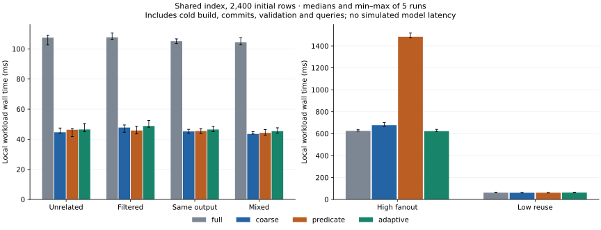

# 实验结果与适用范围

本页仅依据仓库中的本机运行产物。更新器的重跑一致、独立任务正确、模型行为和成本是四种不同指标，不合成一个“系统准确率”。

## 1. 更新机制的正确性

最终成本运行附带 384 个有限状态转换门槛：full / coarse / predicate / adaptive 全部与直接 Python 参考计算一致；positive 出现 **82/384** 次不一致。它只记录旧返回 ID，缺少未来新成员的范围依赖。

[最终领域报告](../experiments/domain-final.json) 使用独立枚举 oracle：74 条链、157 个状态（122 resolved、29 conflict、6 incomplete）。四个正确模式均 **157/157** 状态一致、**74/74** 整链一致；positive 为 **144/157**。生产求解与 oracle 共享 `packaging` 的规范解析，独立的是搜索/赋值验证路径，不是两套完全无共同依赖的软件。

这组检查覆盖动态新政策、撤回、同值换来源、事务一致性、别名、显式时间、未知信息、有限域新候选，以及固定种子的随机依赖图。有限检查不能证明任意 Python 闭包或任意现实知识库的正确性；框架条件见更新语义文档。

## 2. 相同索引下的总维护成本

协议：[cost v3](../research/protocol-cost-v3.md)。2,400 初始行、24 个请求/批、12 批更新；每个配置旋转顺序重复 5 次。表为中位累计**墙钟毫秒**，含初始构图/等值索引、Store 提交、验证和全部请求。远端采集、SQLite 磁盘 I/O 和模型运行不在这个内核微基准里。

| 负载 | full | coarse | predicate | adaptive |
|---|---:|---:|---:|---:|
| 无关插入 | 107.5 | 44.6 | 46.3 | 46.5 |
| 域内过滤项插入 | 107.7 | 47.7 | 45.8 | 48.8 |
| 公开观测不变 | 105.1 | 45.2 | 45.5 | 46.5 |
| 混合变化 | 104.4 | 43.5 | 44.2 | 45.4 |
| 高扇出变化 | 625.4 | 677.0 | 1,483.4 | 622.8 |
| 低复用 | 61.8 | 61.1 | 61.2 | 62.8 |

完整重复值、最小/最大值和操作计数见 [最终确认报告](../experiments/updates-final-v4.json)。图中两块面板的纵轴范围不同。

可以得到的判断是：低变化且重复访问的工作负载值得复用，已有项目范围校验可以取得大部分收益；细粒度谓词在索引已足够便宜时可能不划算。固定密度回退避开了这组高扇出检查成本，但低复用时没有稳定收益。微小差异不能解释成统计显著优势，更不能声称普遍最优或生产环境固定加速比。

`adaptive` 的阈值 .25 是在开发版 v2 后选定；v3 使用新规模和 seed 93。v3 终审发现初始 oracle 副本被误计入公共耗时；v4 修正计时后按同一协议重跑，没有换阈值或负载。公开开发期失败结果；v2/v3 核心源码精确归档。v1 源码是在一次接口加固后才保存，和初始报告 hash 不完全相同，其[说明](../experiments/source-v1/README.md)限制了重放声明。最终数值使用 v4 与当前核心源码。

## 3. 真实 SQLite → 回答 → 训练样例

[六步规则演示](../experiments/demo-rule-final/report.json) 和 [独立审计](../experiments/demo-rule-final/independent-audit.json) 实际执行 5 笔 SQLite 事务：

| 本地实验事件 | requests 选择 / 状态 |
|---|---|
| 初始公开元数据 | 2.32.5 |
| 新增组织策略排除 >=2.32 | 2.31.0 |
| 对无关 anyio 增加策略 | 仍为 2.31.0；训练标签不变 |
| 撤回 requests 组织策略 | 2.32.5 |
| 从本地有限域撤回选定文件 | 2.32.3 |
| 删除 requests 的有限域完备性证书 | incomplete，拒绝给出确定结论 |

这些都是明示的合成变化，不是声称真实 PyPI 发生了这些事件。独立审计核对每步答案、SQLite 事务/有序 outbox、持久源版本与本地快照映射、Session/Publisher/Ledger 的相同内容 SHA、训练标签及清单摘要。此处策略是规则控制器，不能计作模型成功。

## 4. 冻结模型的同证据对照

两条 rank-4 LoRA 均在当前 Mac MPS 上完成：QA 为 157 个 optimizer step、16,522 个监督 token、885.1 秒；行为路线为 174 step、16,534 个监督 token、904.1 秒。相同底座、单一训练 seed、相近监督预算；没有根据保留集结果追加训练。

| 模型 | test 严格完整输出 | future 严格完整输出 | test 整世界通过 | future 整世界通过 |
|---|---:|---:|---:|---:|
| 官方原始底座 | 4/32 | 2/32 | 0/4 | 0/4 |
| 证据条件 QA SFT | 20/32 | 20/32 | 0/4 | 0/4 |
| 更新行为 SFT | 32/32 | 24/32 | 4/4 | 0/4 |

`future` 是合成的未见实体与条件组合，不是实际未来 PyPI 事件。每 split 只有 4 个独立世界；32 个状态相互相关。行为 test 的世界通过率 Wilson 95% 区间约为 [51.0%, 100%]，不能用满分宣称已证明普遍可靠。

共享 QA 四类状态中，两条 SFT 在两个 split 均为 16/16；test 额外更新状态分别为 4/16 与 16/16，future 分别为 4/16 与 8/16。可回答状态（含明确有限域冲突）两条 SFT 都为 12/12；差异来自更新控制行为，而不是新的事实推理能力。

行为 future 的 8 个失败都格式合法：4 个过期 conflict 被直接 answer，4 个 publication 未就绪且多个条件并存的状态误选 refresh。错误优先级的失败不能用 JSON 合法率掩盖。原始底座 future 有 1 个 token-cap 失败，其余评测均 EOS 结束；失败全部保留在分母。原始输出、种子、token、耗时、终止原因和派生摘要见 [完整模型汇总](../experiments/result-summary.json)。

## 5. 长证据接口对照：节省 token 不等于可靠

在六步开发 SQLite 序列上，冻结行为 adapter 的结果如下；这组事件在发现失败后用于接口诊断，**不是独立确认集**。同一模型/权重/解码设置，没有追加训练。

| 视图 | 会话完成 | 新鲜原始动作通过 | 缓存命中 | 新生成 token | 生成秒数 |
|---|---:|---:|---:|---:|---:|
| full，完整事实与完整输出 | 1/6 | 2/5 | 2 | 1,068 | 34.31 |
| reference_context，完整事实与短引用输出 | 1/6 | 2/5 | 2 | 222 | 9.94 |
| reference，同时压缩输入 | 4/6 | 4/5 | 2 | 196 | 8.53 |

每个序列包含一次初始 refresh；因此动作数与完成会话数不同。完整复制有 3 次新鲜坏 JSON，另 2 个失败会话重用了错误缓存。短引用仍可漏掉 status、写错括号或误抄 full_evidence。所有错误均阻断，没有对模型做补字段、补括号或规则替换。表中耗时只含生成，不含模型加载、工具、数据库或独立评分，且未做多轮延迟重复试验。

第二臂保留完整事实输入，有额外引用协议说明，说明仅缩短输出未能解决当前 adapter 的问题。第三臂还改变输入，不能把其分数改善归因为增量执行机制。原始报告见 [接口开发汇总](../experiments/interface-development-summary.json)。默认控制器仍是规则路径。

另实际运行了 [full 引擎＋相同普通语义缓存](../experiments/demo-behavior-full-engine/report.json)：同为 5 次新鲜生成、2 次命中、1/6 会话完成；逐步生成 token IDs 与 coarse 对照完全相同。**此例没有证据证明增量图独占模型调用节省**，其作用应从工具维护成本层单独判断。两个历史版本的缓存 key 编码有所不同，不能把 key 摘要相等当作比较条件。

## 6. 独立长短链确认：引用接口仍未达成可靠模型控制

在上述开发失败后冻结了 [reference v1 协议](../research/protocol-reference-v1.md)：8 个机制族 × 2 条新链 × 3 状态，每视图 48 会话。长副本有 6 个额外真实传递依赖，覆盖至少 5 包、25 引文的输出；不是用短模板替换长证据问题。输入、配置、源码先冻结，再完成三视图规则与独立 oracle 审计，最后运行同一个冻结行为 adapter，无追加训练和确认集调参。

| 视图 | 正确完成会话 | 新鲜原始合同通过 | 实际发出的 answer 符合 oracle | 错误引用被展开 | 新生成 token |
|---|---:|---:|---:|---:|---:|
| full | 12/48 | 28/56 | 8/8 | 不适用 | 9,226 |
| reference_context | 12/48 | 28/55 | 6/6 | 0/6 | 1,945 |
| reference | 23/48 | 39/58 | 19/19 | 0/19 | 2,324 |
| 规则控制器，每个视图 | 48/48 | 不适用 | 40/40 | 引用视图均为 0/40 | 不调用模型 |

每条链内部会话相关。会话正确终止可以是 wait/ask/abstain；实际应回答的状态为 40/48，其余为 5 abstain、2 wait、1 ask。拒绝错误输出提高交付正确性，却不能把 25% 或 47.9% 的完成率写成“100%模型准确率”。有限测试未见错误引用被展开，也不是任意输入安全性的证明。

生成墙钟分别为 416.79、91.25、100.67 秒，缓存命中分别 12、13、10 次；各路线实际动作轨迹因失败而不同。时间只包含新鲜生成，无重复运行区间，不是同成功覆盖下的等效任务加速。完整报告：[full](../experiments/reference-confirm-full/report.json)、[reference_context](../experiments/reference-confirm-reference_context/report.json)、[reference](../experiments/reference-confirm-reference/report.json)；冻结输入与规则审计见 [bundle](../experiments/reference-v1/manifest.json)。

进一步按新鲜生成归因：full 有 15 个坏 JSON、7 个错误载荷、6 个错误动作；reference_context 分别为 12、7、8；reference 为 14、0、5。三臂均无输入超限、token cap 或超时造成的失败。压缩输入后仍有格式和优先级错误，不能把问题全归因于“证据太长”。长副本还采用 prevalidate，短副本不预验证，二者的成绩不能作为单一长度效应；三视图的配对比较保持了相同条件。[派生错误汇总](../experiments/reference-confirmation-summary.json) 保留报告摘要与分组分母。

最终选择保留规则主路径与显式模型阻断，把短引用作为可复现的接口实验，不将其推荐为已解决的模型方案。这里没有发现必须依赖 SFT 才能实现正确知识更新的证据；SFT 的可测增益局限于已有覆盖下的模型接口行为。

## 7. 模型实验的解释原则

模型实验使用官方 DeepSeek 1.5B、本机 MPS、相同受控证据接口。QA 对照与行为训练的监督 token 预算相近，但训练分布和动作覆盖不同：`wait/refresh` 只在行为训练中出现。因此总体差异首先表示针对更新状态的训练覆盖作用，不自动证明更深推理能力或新更新算法。

需要同时查看共享四类状态、额外四类更新状态、完整 payload、格式、终止原因、可答状态，以及按独立世界分组的整链通过情况。一个世界的八个状态相关，不能把它们当作八个独立统计样本。

冻结模型读取新证据后改变答案属于知识刷新；SFT 后同证据行为变化才属于参数适配效果。训练样例重验证不会使已有 adapter 自动遗忘被删除样例。规则策略可以执行闭合状态合同，是本项目中必须保留的强路径。
